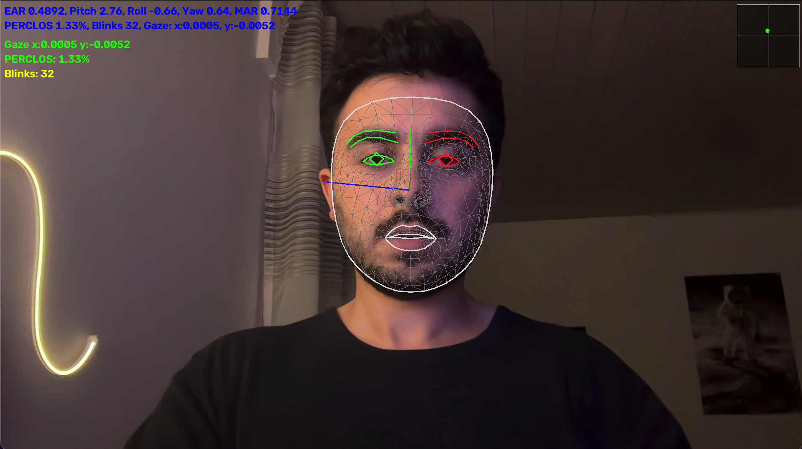
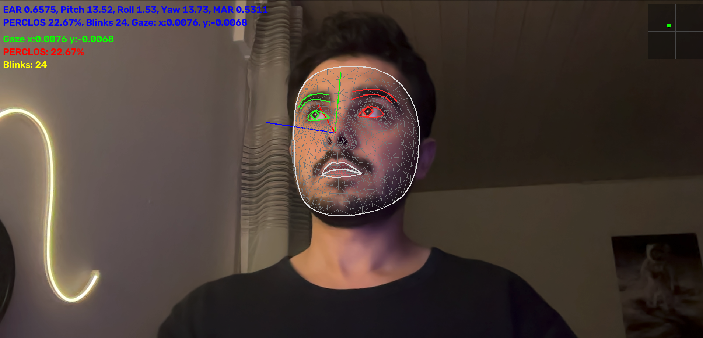
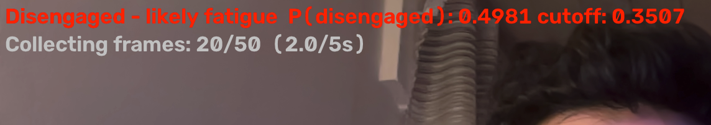

# Attention Lapse Detection

<p align="center">
  
  
</p>

<p align="center">
  
</p>

A machine learning system for detecting attention lapses through facial behavioral features using RNNs (GRU and LSTM).

The system processes video frames to extract facial features and identify patterns associated with engagement and disengagement. When disengagement is detected, a rule-based component estimates possible causes.

The models are trained and evaluated using the [DAiSEE dataset](https://people.iith.ac.in/vineethnb/resources/daisee/index.html).

## How It Works

The system follows a four-stage pipeline:

1. **Face tracking:** MediaPipe detects facial landmarks in video frames.
2. **Feature extraction:** The system extracts eye aspect ratio (EAR), mouth aspect ratio (MAR), head pose, PERCLOS, blink activity, gaze direction, and face visibility.
3. **Attention lapse detection:** Facial features are organized into fixed-length temporal windows and processed using GRU or LSTM models to classify engagement and disengagement.
4. **Cause estimation:** A rule-based component analyzes detected disengagement and suggests fatigue, mind wandering, or an unknown cause.

The system supports both real-time webcam detection and analysis of recorded videos.

## Model Architectures

Four recurrent neural network architectures are implemented:

- Unidirectional GRU
- Unidirectional GRU with attention
- Unidirectional LSTM
- Unidirectional LSTM with attention

The models are evaluated across three frame rates (10, 15, and 30 FPS) and two window lengths (5 and 10 seconds).

The default detection configuration uses a GRU with attention at 10 FPS with 5-second windows.

## Requirements

- Python 3.11
- [uv](https://docs.astral.sh/uv/getting-started/installation/)
- Git LFS
- Webcam or video input for detection

Training and experiments were performed in a Linux environment using an NVIDIA A40 GPU.

## Installation

### 1. Clone the Repository

```bash
git clone https://github.com/ESMAT001/attention-lapse-detection.git
cd attention-lapse-detection
```

### 2. Download Models and Data

```bash
git lfs install
git lfs pull
```

This downloads the trained model checkpoints (`models/*.pt`), the processed feature data (`data/processed/`), and the training logs.

### 3. Install Dependencies

```bash
uv sync
```

### 4. Additional Dependencies (Linux)

```bash
sudo apt-get install -y libgles2 libegl1
```

The tuning and training shell scripts run their jobs in `tmux`:

```bash
sudo apt-get install -y tmux
```

### 5. Run Attention Lapse Detection

Start live detection using your webcam:

```bash
uv run python scripts/detect_live.py --source 0
```

Press `q` to exit.

## Usage

### Real-Time Detection

Run attention lapse detection using a webcam:

```bash
uv run python scripts/detect_live.py --source 0
```

The default configuration uses the saved GRU attention model at 10 FPS with 5-second windows.

To use another trained checkpoint:

```bash
uv run python scripts/detect_live.py --source 0 --model models/NAME.pt
```

Replace `NAME.pt` with the checkpoint filename.

### Facial Feature Visualization

To visualize facial landmarks and extracted features without running the classification model:

```bash
uv run python scripts/run_live.py --source 0
```

Press `q` to close the application.

### Video Analysis

To run detection on a video from the DAiSEE dataset:

```bash
uv run python scripts/detect_video.py --split Test --video 5100462003
```

Add `--show` to display the video while it is processed.

To preview a video with the face mesh overlay and print the extracted features for each frame:

```bash
uv run python scripts/run_video.py --split Test --video 5100462003
```

These commands require the original DAiSEE videos.

## Dataset

The original videos are not included in the repository. Download the dataset separately and place it under `data/raw/`:

```text
data/raw/
├── Labels/
│   ├── TrainLabels.csv
│   ├── ValidationLabels.csv
│   └── TestLabels.csv
└── DataSet/
    ├── Train/
    │   └── <participant>/<clip>/<clip>.avi
    ├── Validation/
    │   └── <participant>/<clip>/<clip>.avi
    └── Test/
        └── <participant>/<clip>/<clip>.avi
```

## Training and Evaluation

The repository provides scripts for reproducing the full pipeline, including feature extraction, hyperparameter tuning, model training, feature ablation, and evaluation.

Run the commands from the repository root.

The repository already contains the outputs of every step, and the scripts skip work that is already saved. To rerun a step from scratch, first move its existing outputs out of `data/processed/`, `tuning/results/` or `experiments/results/`.

### 1. Data Preparation

The processed data is already included through Git LFS, so this step is only needed to rebuild it from the original videos (see [Dataset](#dataset)).

The scripts binarize the DAiSEE engagement labels (levels 0–1 become disengaged, 2–3 engaged), extract facial features into windows, merge the extracted chunks, and clean and scale the windows:

```bash
uv run python scripts/00_binarize_labels.py
uv run python scripts/01_extract_features_parallel.py
uv run python scripts/02_merge_chunks.py
uv run python scripts/03_clean_extracted_data.py
```

Feature extraction runs in parallel. Set the number of worker processes with `--workers N` (default: CPU count minus two).

### 2. Hyperparameter Tuning (Optional)

The selected hyperparameters are available in `hyperparameters/values.json`.

To run hyperparameter search:

```bash
bash run_tuning_gpu.sh
```

Monitor the jobs:

```bash
tmux attach -t search
```

After all jobs finish, merge their results and export the selected settings to `hyperparameters/values.json`:

```bash
uv run python tuning/merge_shards.py
```

### 3. Model Training

The training pipeline covers 192 runs across four architectures, three frame rates, two window lengths, and eight random seeds.

Start training:

```bash
bash run_experiments_prallel.sh
```

Monitor the experiments:

```bash
tmux attach -t experiments
```

After the jobs finish, merge the results:

```bash
head -n 1 experiments/results/grid_gru_10fps.csv > experiments/results/thesis_runs.csv
tail -q -n +2 experiments/results/grid_*.csv >> experiments/results/thesis_runs.csv
```

Select the final configuration:

```bash
uv run python scripts/06_print_winner.py
```

### 4. Feature Ablation

Feature ablation evaluates how individual facial features contribute to model performance.

```bash
for feature in ear mar roll pitch yaw perclos blinks face_present gaze_x gaze_y; do
  uv run python scripts/03_clean_extracted_data.py \
    --fps 10 --window-seconds 10 --drop-columns "$feature"
done
```

Run the ablation experiments:

```bash
uv run python scripts/experiments_script/05_run_experiments.py \
  --device cuda \
  --model gru_uni_attention \
  --fps 10 \
  --window-seconds 10 \
  --ablate ear mar roll pitch yaw perclos blinks face_present gaze_x gaze_y
```

Run the training result merge before the ablation. The merge overwrites `experiments/results/thesis_runs.csv`, and the ablation appends its results to that file.

### 5. Test Evaluation

Evaluate the 56 checkpoints listed in `run_test.sh` (seven configurations, eight seeds each) on the test set:

```bash
bash run_test.sh
```

The metrics are written to `experiments/results/test_results.csv` and the per-clip predictions to `experiments/results/test_probs/`.

### 6. Results Analysis

Run notebooks `00` through `05` in order. These notebooks analyze saved results without retraining models.

## Project Structure

```text
src/attention_lapse_detection/
├── extraction/       Video processing and facial landmark extraction
├── features/         Facial behavior feature calculations
├── core_models/      GRU and LSTM architectures
├── training/         Model training, datasets and metrics
├── detection/        Inference and possible cause estimation
├── utils/            Configuration and helper functions
└── types.py          Shared data structures

scripts/              Data processing, training, evaluation and demos
run_*.sh              Tuning, training and test evaluation jobs
tuning/               Hyperparameter search
hyperparameters/      Selected model configurations
data/                 Dataset and processed feature windows
models/               Trained checkpoints and MediaPipe model
experiments/          Experimental results and predictions
notebooks/            Performance analysis and visualizations
logs/                 Training and evaluation logs
third_party/          External feature extraction implementations
```

## Acknowledgements

Parts of the feature extraction code are adapted from the following open-source implementations, available in `third_party/` with their respective licenses:

- [e-candeloro/Driver-State-Detection](https://github.com/e-candeloro/Driver-State-Detection) (`e_candeloro_Driver_State_Detection`): EAR, head pose, and PERCLOS
- [alireza787b/Python-Gaze-Face-Tracker](https://github.com/alireza787b/Python-Gaze-Face-Tracker) (`alireza787b_Python_Gaze_Face_Tracker_main`): Gaze estimation and blink counting
- [Tandon-A/Drowsiness-Detection-Mediapipe](https://github.com/Tandon-A/Drowsiness-Detection-Mediapipe) (`Tandon_A_Drowsiness_Detection_Mediapipe_main`): MAR

## License

This project is licensed under the [MIT License](LICENSE). Third-party code remains subject to its original license terms.
